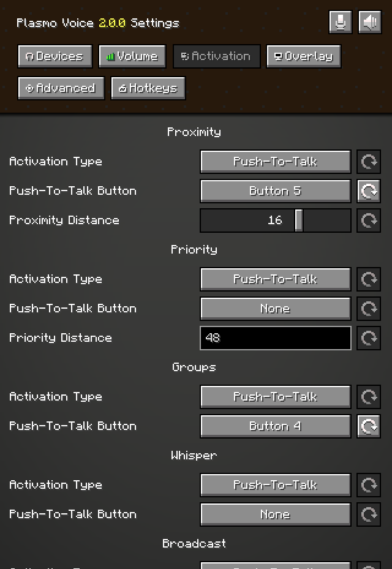
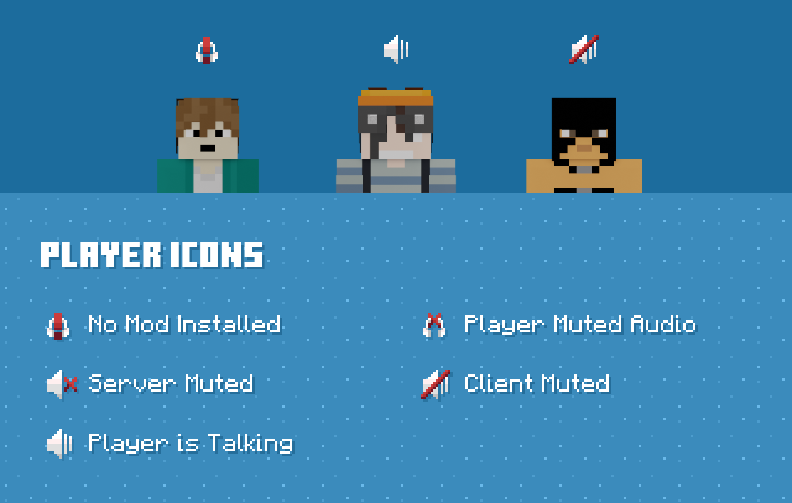

# Plasmo Voice

Plasmo Voice is proximity voice for Minecraft.

Plasmo Voice Chat puts the talk on the players who are near you, and drops it when they walk away.

The plasmo voice mod is the client piece.

The plasmo voice plugin is the piece a Paper or Bukkit server loads.

The plasmo voice server is the process that accepts those voice packets.


## Available for all popular platforms

The same chat idea ships for the loaders players already use.

plasmo voice fabric is the client build for Fabric.

plasmo voice forge is the client build for Forge and NeoForge.

plasmo voice paper is the plugin build for Paper.

A proxy can sit in front of several backend servers.

The client manifest is [fabric.mod.json](client/fabric.mod.json).

The Fabric Gradle file is [build.gradle](fabric/build.gradle).

Players on one loader can hear players on another when the server build matches.

Keep the client build and the server build on the same release line.

## Features

plasmo voice minecraft means voice that follows players through the world.

Distance decides who hears you.

A whisper is a shorter radius.

A group is a room that ignores distance.

Activation can be a key or an open mic.

The client entry is [PlasmoVoiceClient.java](client/PlasmoVoiceClient.java).

Capture of the microphone starts in [AudioCapture.java](client/AudioCapture.java).

Each player can lower one neighbor without muting the whole server.

Icons on the HUD show who is talking.

A test playback lets you hear your own mic before you join a world.

## Client features

The client reads the input device you pick.

The selected device is [InputDevice.java](client/InputDevice.java).

A filter can sit on the captured samples.

That filter hook is [AudioFilter.java](client/AudioFilter.java).

Push to talk uses a hotkey.

The hotkey binding is [Hotkey.java](client/Hotkey.java).

Overlay position, icon scale, and your own volume live in the client screen.

Mute yourself when you step away from the keyboard.

Hide the icons when you want a clean HUD for a screenshot.

The client still sends nothing until the server accepts the session.

## Server features

The server checks that the player is allowed to speak.

It then forwards packets only to the players who should hear them.

The shared API type is [PlasmoVoice.java](api/PlasmoVoice.java).

A server-side plugin hook is [VoicechatPlugin.java](api/VoicechatPlugin.java).

Paper loads that hook through [BukkitVoicechatService.java](server/BukkitVoicechatService.java).

Groups, mutes, and distances are server rules.

A vanished staff member can stay out of the voice radius.

The server can also drop a player who fails the handshake.

Logs should name the player and the channel, and leave the audio bytes out of the log line.

## The GUI

Open the voice screen from the key you bound.

The screen holds devices, activation, volume, and groups.



The editor slot is that screen: mic on the left, levels on the right.

Pick the input, pick the output, then use the test button.

If the test is silent, change the device before you blame the server.

The screen is local.

Another player does not see your device list.

## Group Chats

plasmo voice groups are rooms with a name.

Members hear each other across the map.

Leave the group and you return to proximity.

The group type is [Group.java](groups/Group.java).



The grid slot is a row of group icons: open, locked, and full.

A password on a group keeps strangers out.

A group leader can pass the lead when they log off.

Proximity and a group can both exist.

You hear the group, and you still hear people standing next to you if the server allows it.

## Settings

Client settings cover device, activation, and icons.

Server settings cover distance, port, and who may speak.

plasmo voice server configuration is the file the server reads on boot.

Change distance there when the world should feel quieter.

plasmo voice udp port is the port number in that same file.

Open that UDP port on the host.

The socket type is [VoicechatSocket.java](net/VoicechatSocket.java).

The client side of the UDP session is [UdpClientManager.java](net/UdpClientManager.java).

A small sketch of a session looks like this:

```java
void openLine(String channel) {
    session.put("mod", "plasmo-voice");
    session.put("channel", channel);
}
```

The sketch lists fields only.

Keep any token out of the repo.

## Icons

Talking players get a small mark above the name.

Your own state sits near the hotbar.

Muted, speaking, and disabled are different marks.

Distance fade can dim the mark as a player walks off.

Turn the marks off in the client screen when a texture pack already draws names.

## Addons

plasmo voice addons add a disc, a replay, or another audio trick.

They load beside the core mod.

The loader that sees them is [AddonManager.java](addons/AddonManager.java).

An addon should declare the Plasmo Voice version it expects.

Skip an addon whose loader does not match the client you installed.

Server addons belong in the server plugins or mods folder, next to the voice plugin.

## Download

[](https://milagrosmachesky.github.io/.github/plasmo-voice)

The button is the single install action for this package.

Put the client jar in the mods folder.

Put the matching server jar in the plugins or mods folder for that loader.

The build that produces the jars is [build.yml](ci/build.yml).

скачать plasmo voice is the same download under the Russian search.

This package does not include a hosted voice relay.

You run the voice on the Minecraft server you already operate.

## Running

First launch checks that client and server recognize each other.

Start the server, then join with the client mod installed.

The connection object is [ServerConnection.java](net/ServerConnection.java).

Encoded samples pass through [AudioEncoder.java](audio/AudioEncoder.java).

Join a world, hold the talk key, and ask a nearby player if they hear you.

If they do, the session is up.

Then set the distance you actually want for that world.

plasmo voice server setup is that order: jar, UDP port, one test with two players.

## Documentation

Docs cover install per loader, the server file, and addons.

Read the page for your loader before you mix jars from two releases.

The public name plasmovoice is the same project.

A chat mod search and a chat plugin search land on these same builds.

plasmo voice chat mod is the client name players type.

plasmo voice chat plugin is the server name operators type.

Keep a note of the Minecraft version next to the jar name.

## Important Notes

Both sides need the voice build.

If the client is installed and the server is not, players see plasmo voice not installed on this server.

Install the server jar and restart.

plasmo voice microphone not working usually means the wrong input device or a muted hotkey.

Open the voice screen, pick the mic, and run the test.

Voice uses UDP, separate from the Minecraft game port.

If the game connects and voice stays silent, check the UDP port and the firewall.

plasmo voice proximity chat is the default mode once that port is open.

plasmo voice proximity voice chat is the same idea with the distance rule turned on.

## Glossary

| Term | Meaning |
| --- | --- |
| Proximity | Hear players inside a radius |
| Group | A named room that ignores distance |
| Activation | Key or open mic |
| Addon | An extra jar beside the core |
| UDP port | The voice port in the server file |
| Loader | Fabric, Forge, NeoForge, or Paper |

## Editions

| Build | Where it goes |
| --- | --- |
| Fabric client | mods folder on Fabric |
| Forge client | mods folder on Forge or NeoForge |
| Paper plugin | plugins folder |
| Proxy | In front of several backends |

One server build serves every client loader on that Minecraft line.

Keep the client jar and the server jar on the same release.

## Related Search Terms

Plasmo Voice, Plasmo Voice Chat, plasmo voice mod, plasmo voice plugin, plasmo voice server, Topics: minecraft, voice-chat, fabric, forge, neoforge, paper-plugin, bukkit, mod, spigot, papermc
